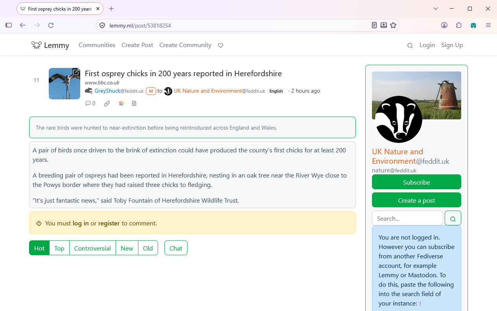

# Lemmy Home Instance Redirector

[](https://github.com/ALERTua/lemmy-home-instance-redirector/actions/workflows/ci.yml)
[](LICENSE)

A Firefox add-on that opens Lemmy and PieFed links on your home Lemmy instance, where you are logged in and can vote, comment and subscribe.



## Features

- Opens posts, comments, communities and users from any Lemmy or PieFed server on your home instance.
- Works past the login page of private Lemmy servers, for example `feddit.uk`, and of PieFed servers that hide their content from guests, for example `piefed.ca`.
- Leaves other sites alone. It checks the page itself and sends no request for a site that is not Lemmy or PieFed.
- Does not redirect when you come from your home instance, for example through the link to the original page. To open one page without a redirect, add `#noredirect` to its address.
- Needs no login data. Its requests carry no cookies.

## Settings

After the installation, the add-on opens its settings page. Enter the host name of your home instance, for example `sh.itjust.works`. The add-on checks that the server answers as Lemmy before it saves the value. Until you save a home instance, the add-on does not redirect.

| Settings page | Toolbar popup |
|---|---|
|  |  |

To change the home instance later, click the add-on button on the toolbar, or open the settings of the add-on in `about:addons`.

## How it works

- A content script runs on addresses with the paths `/post/`, `/comment/`, `/c/` or `/u/`. It reads the `<head>` of the page. A Lemmy page has an inline script that sets `window.isoData`. A PieFed page links the `high_contrast` theme as an alternate stylesheet. On any other site, the content script stops.
- A private server sends a guest from the address of a post to its login page, so the page of the post never loads. The background script watches redirects of top-level pages and catches this case.
- For a found object, the background script asks the server of the page for the ActivityPub ID of the object. Then it asks the home instance for its local copy with `resolve_object`. If the home instance already has the object, the browser opens it directly. If not, the browser opens the search page of the home instance with the ActivityPub ID, and that page fetches the object when you are logged in.

## Privacy

The add-on sends the address of a Lemmy or PieFed page to the server of that page and to your home instance. It sends nothing to the author or to a third party. For details, read [PRIVACY.md](PRIVACY.md).

## Development

You need Node.js 22 or later.

```bash
npm ci
```

| Command | What it does |
|---|---|
| `npm run start` | Starts Firefox with the add-on from `src/` and reloads it after each change. |
| `npm run lint` | Checks the add-on with the rules of addons.mozilla.org. |
| `npm run build` | Packs `src/` into a `.zip` file in `dist/`. |
| `npm run sign` | Signs the add-on as unlisted on addons.mozilla.org and puts the `.xpi` file into `dist/`. |

### Sign a release

1. Copy `.env.example` to `.env`, and fill in the API key from https://addons.mozilla.org/developers/addon/api/key/. Never commit `.env`.
2. Increase `version` in `src/manifest.json` and in `package.json`. addons.mozilla.org refuses a version that it already signed.
3. Add the changes to `CHANGELOG.md`.
4. Run `npm run sign`.

### End-to-end tests

`tools/addon_test.py` installs the add-on into Firefox, opens live Lemmy and PieFed pages and prints PASS or FAIL for each scenario. `tools/screenshots.py` makes the screenshots in `docs/screenshots/`. Both scripts drive Firefox through Selenium with a helper module of the author's machine, so they do not run elsewhere without changes.

## License

[GPL-3.0](LICENSE)
